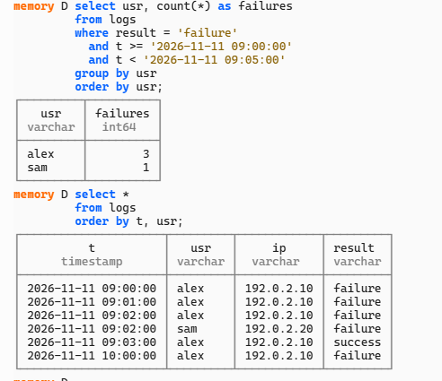
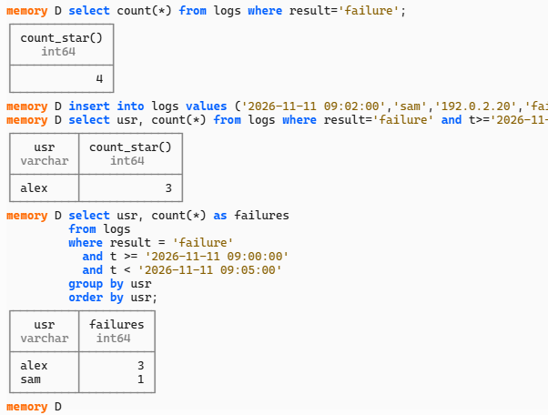
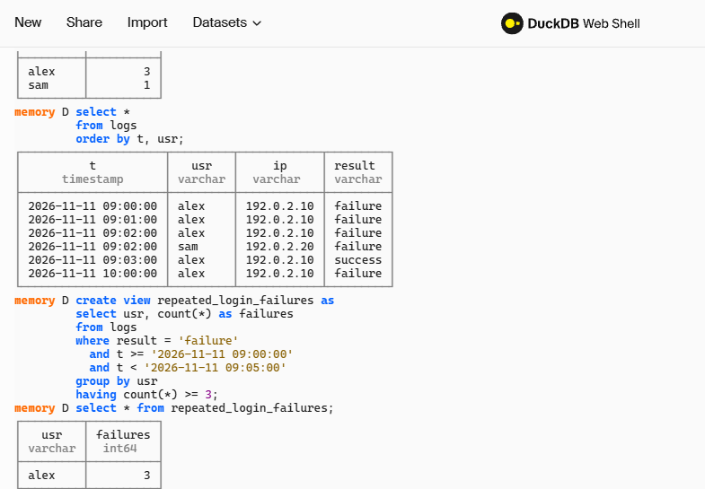
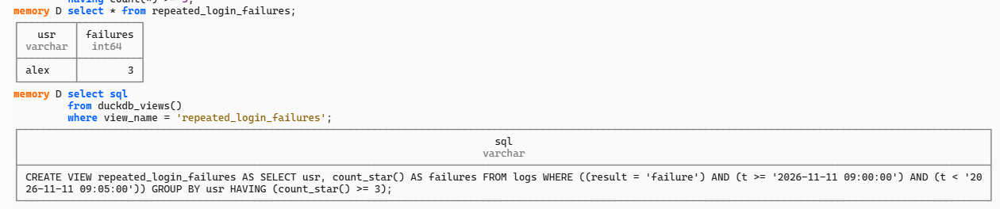

# Security Log Analysis and Detection with SQL

I used DuckDB Web Shell to review synthetic login events and build a basic detection for repeated failed logins. This was a guided beginner lab using six manually entered training events. DuckDB was the database tool. I did not deploy a full SIEM or collect activity from a real company.

## What I did

I created a table, added login events, and searched them in time order. I tested thresholds of two and three failed logins, then added a fixed five-minute filter. I saved the final query as a view called `repeated_login_failures`.

## Results

The final dataset and saved rule are visible in the screenshots below.

| Test | Observed result | Evidence |
|---|---|---|
| Failures per user from 09:00 up to 09:05 | alex: 3; sam: 1 | Screenshot 02 |
| At least 3 failures in that window | alex: 3; sam excluded | Screenshot 03 |
| Later failure at 10:00 | Present in dataset; excluded from fixed window | Screenshots 01 and 03 |
| Successful login at 09:03 | Present in dataset; excluded by failure filter | Screenshots 01 and 03 |

Earlier threshold tests were also performed during the guided exercise. The no-match result at threshold three, before the third failure was added, was reported in chat rather than captured in the included screenshots. Those tests were not repeated for this package.

## Investigation notes

I found three failed logins for alex within five minutes, followed by a successful login from the same IP. That alone does not prove someone broke into the account. I would need more login history and account activity to figure out what happened.

My decision was that the case needed more investigation. I would compare the IP with known login history and review account changes and sensitive actions after the successful login. These were proposed next checks. I did not perform them because the dataset does not include that information.

## Limits

There are only six synthetic events. They cannot establish normal behavior, identify the person logging in, or explain why the logins failed. A successful login does not establish authorization.

The rule uses one fixed date range, not a rolling window. It groups by username, not by IP or session. The timestamps have no specified timezone. The view is queried manually and does not send alerts. These tests show how the rule behaves on this small dataset, not its accuracy on real activity.

## Files and evidence

- `lab.sql`: Recreates the verified dataset and saved detection in a fresh DuckDB database. It was reconstructed for this package from the screenshots, not exported from my browser session. The combined script has not been rerun as a separate test.
- `screenshots/`: Original screenshots submitted during my work. No results were generated or altered for the write-up.

### 01: Complete synthetic dataset

### 02: Comparison counts

### 03: Saved detection and result

### 04: Stored rule definition

## Tool reference

[DuckDB-Wasm official documentation](https://duckdb.org/docs/stable/clients/wasm/overview). Findings in this write-up come from my submitted screenshots and responses in the guided lab, not from the documentation.
